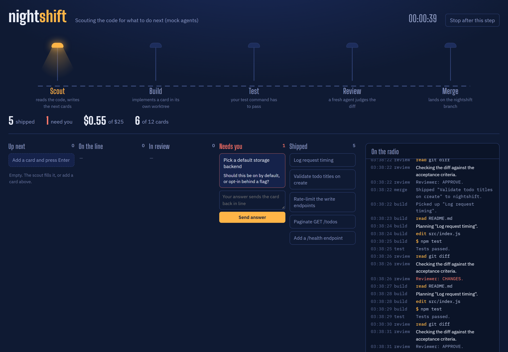
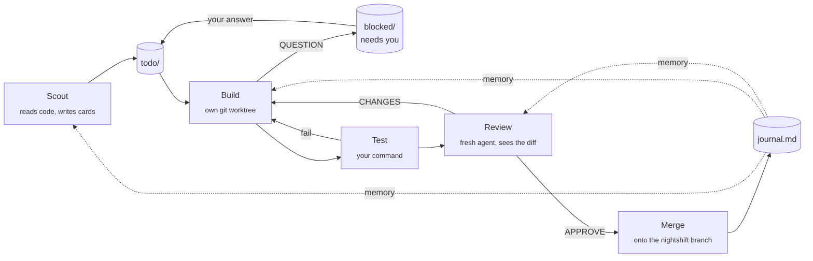

<h1 align="center">nightshift</h1>

<p align="center"><b>An AI dev team that works your backlog while you sleep.</b><br>
Scout → Build → Test → Review → Merge, on Claude Code, with a live control room that shows every move.</p>

<p align="center"><a href="https://github.com/pshen44/nightshift/actions"></a>  </p>

<p align="center"></p>

```bash
npx github:pshen44/nightshift demo
```

That opens the control room with mock agents (no tokens, no setup) so you can watch a whole shift: cards get picked up, built, sent back by the reviewer, merged, and one gets stuck on a question only you can answer.

---

## You go to bed. It keeps shipping.

Scheduled AI runs mostly disappoint for the same reason: **every run starts from zero.** It re-reads your repo, forgets what it did yesterday, guesses at decisions you'd have made in two seconds, and burns your usage doing it.

nightshift fixes that with three boring ideas:

1. **The context lives in the repo, not the chat.** `MISSION.md` says what the project is and where it's going. `journal.md` records what every card shipped or why it got stuck. Every agent reads both before it starts, so run #40 knows what runs #1 to #39 learned.
2. **Separate agents check each other.** The builder never grades its own work. Your test command has to pass, then a fresh reviewer, who has never seen the builder's reasoning, reads the diff against the card. Changes go back for another round.
3. **It asks instead of guessing.** When a card needs a human call (a product choice, a paid service, a credential) the builder stops and files a question. You answer it from the dashboard in the morning and the card goes back in line.



## Use it on your repo

Needs [Claude Code](https://docs.claude.com/en/docs/claude-code) (logged in) and Node 20+.

```bash
cd your-repo
npx github:pshen44/nightshift init       # creates .nightshift/
# write .nightshift/MISSION.md (5 minutes, it is the most important file)
npx github:pshen44/nightshift add "Paginate GET /todos" "Done when: ?limit and ?cursor work and are tested."
npx github:pshen44/nightshift run --test "npm test"
```

Open **http://localhost:4242**. Leave it running. In the morning:

```bash
git log --oneline main..nightshift       # what shipped overnight
gh pr create --base main --head nightshift --fill
```

nightshift **never touches your branch.** Each card is built in its own worktree on its own branch, and approved work fast-forwards onto a `nightshift` branch for you to review and merge.

## The board is just folders

```
.nightshift/
  MISSION.md        you write this: what, where it's going, the rules
  journal.md        nightshift writes this: the team's memory
  config.json
  board/
    todo/           cards waiting, worked in filename order
    doing/
    review/
    blocked/        questions and failures that need you
    done/
```

A card is a markdown file. Drop one in `todo/` with any editor, rename it `000-urgent.md` to jump the line, or drag it to `done/` to cancel it. Agents append their build notes, test failures and reviews to the card, so each card ends up as a complete record of how it was made.

## Config

`.nightshift/config.json`. Every key is optional.

| Key | Default | What it does |
|---|---|---|
| `test` | `null` | Command that must pass before review, e.g. `"npm test"`. The builder may run it too. |
| `maxTasks` | `10` | Cards per shift. |
| `budgetUsd` | `25` | Stop after agents report this much spend. |
| `agentBudgetUsd` | `5` | Cap for any single agent run. |
| `maxRounds` | `3` | Build → test → review attempts before a card is blocked. |
| `forever` | `false` | Wait for new cards instead of stopping. |
| `limitBackoffMin` | `20` | When you hit a usage limit, sleep this long and continue. |
| `scout.enabled` / `scout.batch` | `true` / `3` | Let the scout write new cards when the backlog runs dry. |
| `branch` / `base` | `"nightshift"` / current | Where approved work lands, and where it starts from. |
| `roles.<scout\|builder\|reviewer>` | see below | `model`, `permissionMode`, `allowedTools` per agent. |

Defaults: the scout and reviewer run on `sonnet` with read-only tools. The builder uses your default model with `acceptEdits`: it can read and write files in its worktree and run your `test` command, nothing else. If your builds need more (installing packages, running a dev server), add tools to `roles.builder.allowedTools`, e.g. `"Bash(npm install *)"`. Cheaper nights: set every role to `"haiku"`; a full scout → build → review cycle on a small card costs around $0.20–0.30 that way.

## How it stays safe

- Work happens in throwaway git worktrees. Your checkout and your main branch are never modified.
- The builder can't run arbitrary shell commands unless you allow them. The scout and reviewer can't write at all.
- Budgets per agent and per shift, plus a hard cap on cards.
- The dashboard binds to `127.0.0.1` and rejects cross-origin requests.
- Nothing is pushed anywhere. Opening the PR is your call.

If you want a fully unattended builder with every tool, run nightshift inside a container or VM and set `roles.builder.permissionMode` to `bypassPermissions` there. Don't do it on the laptop with your SSH keys on it.

## Run it every night

- **macOS/Linux:** `crontab -e` → `0 1 * * * cd ~/code/app && npx github:pshen44/nightshift run --no-dashboard >> .nightshift/shift.log 2>&1`
- **Windows:** Task Scheduler → daily at 1:00 → `cmd /c "cd C:\code\app && npx github:pshen44/nightshift run --no-dashboard"`. Turn off sleep, or the shift sleeps too.
- **Always on:** `nightshift run --forever` and add cards from the dashboard whenever you think of them.

For a longer guide on building always-on AI workflows (and when to use GitHub Actions, routines or the Agent SDK instead), see [docs/AUTOMATION.md](docs/AUTOMATION.md).

## Commands

```
nightshift init                 set up .nightshift/ in this git repo
nightshift add "title" [body]   put a card on the backlog
nightshift run [options]        start the shift
nightshift status               print the board
nightshift demo                 a full shift with mock agents
```

`run` takes `--test`, `--max-tasks`, `--budget`, `--forever`, `--no-scout`, `--port`, `--no-dashboard`, `--open` and `--mock`.

## Under the hood

About 900 lines of plain Node, zero dependencies. Each agent is one `claude -p --output-format stream-json` process; nightshift reads the stream, so every tool call shows up in the dashboard as it happens. State is files and git. There is no database, no daemon and no account.

```
src/shift.js     the loop: pick, build, test, review, merge, remember
src/agent.js     runs claude headless, parses its stream; also the mock agent
src/prompts.js   the three role prompts (edit these, they're the product)
src/board.js     the folder-as-kanban
src/server.js    dashboard + server-sent events
public/          the control room, one HTML file
```

`npm test` runs the whole pipeline end to end against a temporary repo with mock agents.

## Roadmap

Ideas, in rough order. PRs welcome.

- [ ] Parallel lanes: several builders on independent cards at once
- [ ] GitHub Issues as the board (label `nightshift` to enqueue)
- [ ] Phone notification when a card needs you
- [ ] Replay a finished card's run from its log
- [ ] Per-card model overrides (`model: opus` in the card)
- [ ] Prompt overrides in `.nightshift/prompts/`

## License

MIT
